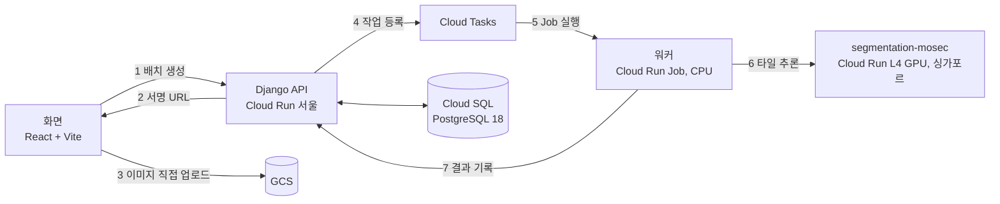

# 병리영상 분석 CDSS — 유방암 sTIL 계측

> 팀 프로젝트의 공개 사본입니다. 원본은 `medical-ai-group-3/cdss-project`(비공개)입니다.
> 커밋 기록과 작성자는 원본과 같습니다. 원본 기록에서 개발용 키 값과 개인 개발 도구 설정 파일을 지우고, 서버 주소 일부를 가렸습니다.

유방암 H&E 병리 이미지를 받아 sTIL(종양 침윤 림프구) 비율을 계산하는 의사결정 보조 시스템입니다.
Conformal Prediction으로 예측 구간을 붙이고, 구간이 판정 기준에 걸치면 판정을 유보합니다.

| 항목 | 내용 |
|---|---|
| 기간 | 2026.07 |
| 인원 | 5명 |
| 내 역할 | Django REST API(`backend/`), GCP 인프라(Cloud Run, Cloud SQL, Cloud Tasks, GCS) |

## 핵심 가치

1. **큰 이미지도 업로드:** 이미지가 Django를 거치지 않고 서명 URL로 GCS에 바로 올라갑니다. Cloud Run 요청 한도 32MB를 넘는 이미지도 올릴 수 있습니다.
2. **불확실하면 판정 유보:** MC Dropout 20회로 불확실도를 재고, Conformal Prediction으로 90% 예측 구간을 냅니다.
3. **GPU는 추론할 때만:** 다운로드, 타일 나누기, 결과 조립은 CPU 워커가 합니다. GPU 서비스는 추론 요청만 받습니다.

## 내가 만든 것과 결과

| 한 일 | 결과 |
|---|---|
| 업로드 방식 설계 (서명 URL로 GCS 직접 업로드) | 실측 이미지 151장: 평균 31.7MB, 최대 141.1MB, 54장이 32MB 초과. 모두 업로드 가능 |
| DRF API 7개 경로 (배치 생성, 시작, 조회, 작업 조회, 워커 결과 기록 등) | 프런트, 워커, DB 사이 계약을 API 하나로 묶음 |
| 이미지 1장마다 상태 5단계 (`waiting` → `processing` → `stil_done` → `done`, `error`) | DB에는 영문 키, 화면에는 한글 라벨. 문구를 바꿔도 API가 바뀌지 않음 |
| Cloud Tasks로 Cloud Run Job 실행 | Cloud Run Admin API `:run` 호출, 작업 정보는 환경 변수 `JOB_PAYLOAD`로 전달 |
| Cloud Run 배포 (서울 리전) | Django API 배포와 동작 확인 완료 |

## 구조

| 구성 요소 | 리전 | 내용 |
|---|---|---|
| Django API `bcss-api` | 서울 | 배치와 작업 관리, 서명 URL 발급, 결과 저장 |
| Cloud Tasks `inference-queue` | 서울 | 작업 1건마다 워커 실행 요청 |
| 워커 `cdss-worker` | 서울 | 이미지 다운로드, 512×512 타일 추론 요청, sTIL과 예측 구간 계산 |
| `segmentation-mosec` | 싱가포르 | ONNX Runtime 추론. Cloud Run GPU가 서울을 지원하지 않아서 싱가포르에 둠 |
| Cloud SQL, GCS | 서울 | 작업 상태, 원본과 결과 이미지 |

## 기술 스펙

| 영역 | 기술 |
|---|---|
| 백엔드 | Python 3.12, Django 5.2, DRF 3.16, gunicorn, psycopg2 |
| GCP | Cloud Run, Cloud Run Job, Cloud Tasks, Cloud SQL (PostgreSQL 18), GCS |
| 추론 | PyTorch 2.6, ONNX Runtime, Mosec |
| 화면 | React 19, Vite 8, Tailwind CSS 4, OpenSeadragon, Recharts |

## AI 모델

| 항목 | 내용 |
|---|---|
| 모델 | Attention U-Net (ResNet34 인코더), 5개 조직 클래스 분할 |
| 입력 | 512×512 RGB 타일 |
| 데이터 | BCSS (TCGA-BRCA H&E), 슬라이드 151장. 기관 단위로 학습 91장, 보정 15장, 테스트 45장 분할 |
| sTIL | `immune / (immune + stroma) × 100`, MC Dropout 회차별 값의 중앙값 |
| 성능 (테스트 45장) | sTIL MAE 7.152, 기준값 10% 판정 정확도 91.1% |
| 예측 구간 | CV+ Conformal, 90% 목표, 테스트 커버리지 95.6% (43/45) |
| 서빙 | ONNX 변환 후 PyTorch와 최대 오차 3.13e-06, 타일 1개 7.6초 (MC Dropout 포함) |

- 모델 학습은 팀원이 맡았습니다. 수치는 `model-training/serving_model/SERVING_PARAMS.md`에 있습니다.

## 프로젝트 종료 시점 상태

| 구성 요소 | 상태 |
|---|---|
| Django API, Cloud SQL, GCS, Cloud Tasks | 배포와 동작 확인 완료 |
| GPU 추론 서비스 | 실제 모델로 동작 확인 |
| 워커 | 배포하지 못함 |
| MedGemma 판독 보고서 | 계획 단계 |

## 실행

1. `backend/`에서 패키지를 설치합니다: `pip install -r requirements.txt`
2. 환경 변수를 설정합니다: `DJANGO_SECRET_KEY`, DB 접속 정보, GCP 프로젝트와 버킷 이름
3. 개발 서버를 실행합니다: `python manage.py migrate && python manage.py runserver`
4. 화면을 실행합니다: `cd frontend && npm install && npm run dev`

- 업로드와 추론에는 GCP 프로젝트(GCS, Cloud Tasks, Cloud Run)가 필요합니다.
- 배포 명령은 `worker_dev/INTERFACE.md`에 있습니다.

## 폴더

| 폴더 | 담당 | 내용 |
|---|---|---|
| `backend/` | **Yun-sooyong** | Django REST API, GCP 연동 |
| `model-training/` | ilun | Attention U-Net 학습, ONNX 변환 |
| `serving/segmentation-mosec/` | jungeun | GPU 추론 서비스 (MC Dropout) |
| `serving/medgemma-mosec/` | spgummo0905 | MedGemma 서비스 |
| `worker_dev/` | spgummo0905 | 워커: Conformal Prediction, sTIL 계산 |
| `frontend/` | da-hee-da | React 화면 |
| `docs/` | 공통 | 구조 설명서, API 명세 |
