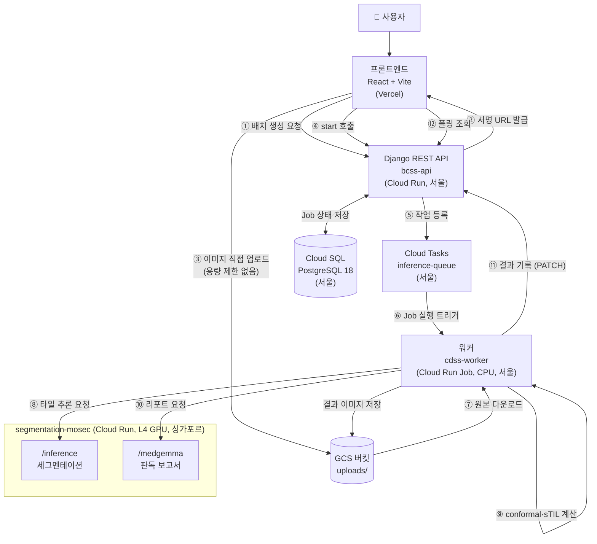

# 시스템 구조 설명서

**작성:** 윤수용 (backend/인프라) · **작성일:** 2026-07-27
**목적:** 각 구성요소가 무슨 역할을 하고 데이터가 어떻게 흐르는지 한 문서로 파악한다.

---

## 1. 한눈에 보기

이 시스템은 **유방암 병리 이미지를 받아 sTIL(종양침윤림프구) 비율을 계산하고,
Conformal Prediction으로 신뢰구간과 판정유보 여부를 판단한 뒤, MedGemma로 판독 보고서를 생성**한다.



---

## 2. 구성요소별 역할

### 2.1 프론트엔드 — React + Vite (Vercel)

**담당:** 정다희 · **배포:** https://ccdss-project.vercel.app

사용자가 이미지를 올리고 결과를 확인하는 화면이다. 서버를 두지 않는 **정적 사이트**라
Vercel에 배포되어 있고, 모든 데이터는 Django API를 통해 주고받는다.

| 화면 | 역할 |
|---|---|
| 대시보드 | 최근 케이스 목록, 확인 필요 케이스 |
| 업로드 | 이미지 여러 장 선택 + 모델 선택 |
| 로딩 | 4초 간격으로 진행 상황 폴링 |
| 요약/상세 | sTIL 값, 예측구간, 판독 보고서 표시 |

> 업로드는 **3단계**로 동작한다: 배치 생성 요청 → GCS 직접 업로드 → start 호출.
> 파일이 Django를 거치지 않는 이유는 5.1 참고.

### 2.2 Django REST API — `bcss-api`

**담당:** 윤수용 · **리전:** `asia-northeast3`(서울) · **상태:** ✅ 배포·검증 완료

시스템의 **관문이자 상태 관리자**다. 무거운 연산은 하지 않고, 아래 네 가지만 한다.

1. **업로드 중개** — GCS 서명 URL을 발급한다 (파일 자체는 안 받는다)
2. **작업 상태 관리** — Batch/Job을 Cloud SQL에 기록한다
3. **작업 등록** — Cloud Tasks에 추론 작업을 넣는다
4. **결과 수집** — 워커가 보내온 결과를 저장하고 프론트에 제공한다

**엔드포인트**

| 메서드 | 경로 | 역할 |
|---|---|---|
| GET | `/api/health` | 헬스체크 (Cloud Run이 확인) |
| POST | `/api/batches` | 배치 생성 + 서명 업로드 URL 발급 |
| POST | `/api/batches/{id}/start` | 업로드 완료 → 큐 등록 |
| GET | `/api/result/{batch_id}` | 요약(총/완료/에러) + job 리스트 |
| GET | `/api/jobs/{job_id}` | 개별 결과 조회 |
| PATCH | `/api/jobs/{job_id}/` | **워커가 결과를 기록** |

**데이터 모델**

```
Batch (묶음 = 업로드 1회)
  ├─ id, model_name, created_at
  └─ total / done_count / error_count / status   ← 저장하지 않고 Job을 세서 계산
      └─ Job (이미지 1장)  × 1~15
           ├─ id, gcs_image_path, model_name, status
           ├─ stil_value, conformal_prediction_value
           ├─ gcs_result_path, medgemma_report
           └─ error_message, created_at, updated_at
```

`Batch`의 개수를 컬럼으로 저장하지 않는 이유: 워커가 동시에 여러 Job을 갱신할 때
카운터가 어긋날 수 있어서, 조회 시점에 `Job`을 세는 방식이 항상 정확하다.

**작업 상태 전이**

```
waiting(대기) → processing(진행중) → stil_done(sTIL 완료) → done(완료)
                                  ↘ error(오류)
```

### 2.3 세그멘테이션 서비스 — `segmentation-mosec`

**담당:** 서정은 · **리전:** `asia-southeast1`(싱가포르) · **상태:** ✅ 실모델 동작 확인

GPU에서 **U-Net 계열 모델로 조직을 픽셀 단위 분류**하는 추론 서버다.
[mosec](https://github.com/mosecorg/mosec) 프레임워크를 쓰며, 요청을 모아 배치로 처리한다.

| 설정 | 값 | 의미 |
|---|---|---|
| GPU | NVIDIA L4 × 1 | Ada 아키텍처, 24GB VRAM |
| CPU/메모리 | 4 / 16Gi | Cloud Run GPU 최소 요구치 |
| `MC_DROPOUT_N` | 25 | **이미지 1장당 추론을 25회** 반복 |
| `TILE_SIZE` | 512 | 입력 타일 한 변 |
| `FORCE_DUMMY` | 0 | 진짜 ONNX 모델 사용 (1이면 더미) |
| concurrency | 4 | 동시 처리 요청 수 |
| min-instances | 0 | 요청 없으면 인스턴스 0 → **과금 없음** |

**파이프라인 (mosec 2단계)**
```
Preprocess  : 이미지 디코딩 → 512×512 리사이즈 → 정규화(CHW)
Inference   : MC Dropout 25회 추론 → argmax → 마스크 25장 반환
```

**MC Dropout이 왜 25회인가**
추론할 때마다 드롭아웃을 켜서 **조금씩 다른 결과 25장**을 얻는다.
그 25장의 sTIL 값이 얼마나 흩어지는지(표준편차)가 곧 **모델의 불확실도**가 된다.
이 값이 Conformal Prediction의 입력이 된다.

**클래스 인덱스 규약 (전 팀 공통)**
```
0=tumor, 1=stroma, 2=immune, 3=necrosis, 4=other, 255=ignore
```

**호출 규격**
```
POST /inference
  Content-Type: application/msgpack
  Authorization: Bearer <ID 토큰>        ← 비공개 서비스라 필수
  body: msgpack({job_id, image: <PNG bytes>, model_name})

응답: msgpack({job_id, model_name_used, mc_samples, height, width, num_classes, masks})
```

**실측 성능:** 512×512 타일 1개 → **7.6초** (MC 25회 포함)

### 2.4 워커 — `cdss-worker`

**담당:** 박검모 · **리전:** `asia-northeast3`(서울) · **상태:** ❌ **미배포 (현재 병목)**

파이프라인의 **조립 담당**이다. GPU가 필요 없는 작업(다운로드·타일링·통계 계산·통신)을 맡아,
비싼 GPU 인스턴스가 그런 일에 시간을 쓰지 않도록 한다.

Cloud Run **Job**(서비스가 아님)으로 배포된다. HTTP 서버 없이 위에서 아래로 실행되고 끝난다.

**하는 일**
```
① GCS에서 원본 이미지 다운로드
② 512×512 타일로 분할              ← Cloud Run 32MB 제한 회피
③ 타일마다 /inference 호출          ← 세그멘테이션
④ 마스크를 원본 크기로 재조립       → mc_stack (N, H, W)
⑤ sTIL + Conformal 계산 (numpy)     → Django에 1차 기록 (stil_done)
⑥ /medgemma 호출                    → 판독 보고서
⑦ Django에 2차 기록 (done)
```

**입력** — Cloud Tasks가 환경변수로 주입
```json
JOB_PAYLOAD = {
  "job_id": "...",
  "model_name": "attention_unet_v1",
  "gcs_image_path": "gs://.../uploads/xxx.png",   ← 여기서 읽고
  "gcs_result_path": "gs://.../results/xxx.png"   ← 여기에 결과 이미지를 쓴다
}
```

**출력** — Django에 PATCH
```
1차: {"status":"sTIL 완료", "stil_value":4.75, "cp_value":0.88}
2차: {"status":"완료", "medgemma_report":{...}}
```

### 2.5 MedGemma — `/medgemma` 라우트 (예정)

**담당:** 박검모 · **상태:** ❌ 2단계 예정

의료 특화 VLM(`google/medgemma-4b-it`)으로 **세그멘테이션 이미지와 수치를 보고 판독문을 생성**한다.
GPU가 필요하므로 **세그멘테이션과 같은 GPU 서비스에 라우트만 추가**한다
(mosec은 여러 경로에 독립 파이프라인을 등록할 수 있다).

L4의 24GB VRAM에 세그 U-Net(수백 MB) + MedGemma 4B(BF16 약 8GB)가 함께 올라간다.

**출력 형식**
```json
{
  "case_id": "5482ca2e",
  "model_used": "attention_unet_v1",
  "stil_ratio": 47.0,
  "uncertainty": {"cp_value": 0.86, "lower": 38.0, "upper": 56.0, "abstain": true},
  "segmentation_summary": "조직 구성 요약...",
  "findings": "판독 소견...",
  "disclaimer": "본 결과는 AI 보조 도구의 출력이며 의료진의 최종 판단이 필요합니다."
}
```

### 2.6 데이터 저장소

| 저장소 | 위치 | 용도 |
|---|---|---|
| **Cloud SQL** (PostgreSQL 18) | 서울 | Batch/Job 상태·결과 수치. Django만 접근 |
| **GCS** `...-data` | 서울 | `uploads/` 원본 이미지, `results/` 세그 결과 이미지 |
| **GCS** `...-models` | 서울 | 학습된 ONNX 모델 가중치 |
| **Cloud Tasks** `inference-queue` | 서울 | 추론 작업 큐. 실패 시 자동 재시도 |

> 워커는 **DB에 직접 접속하지 않는다.** 쓰기 경로는 Django REST API 하나뿐이다.
> 스키마 변경이 워커에 영향을 주지 않고, 권한 관리도 단순해진다.

---

## 3. 전체 파이프라인 상세

### 3.1 업로드 단계

```
① 프론트 → Django   POST /api/batches
                    {model_name, files:[{filename, content_type}...]}

   Django는 파일을 받지 않는다. 대신
     - Batch 1개 + Job N개를 생성 (status=waiting)
     - 각 Job의 저장 위치를 미리 정하고
     - 그 위치에 업로드할 수 있는 서명 URL을 발급한다

② Django → 프론트   {batch_id, uploads:[{job_id, upload_url, gcs_path}...]}

③ 프론트 → GCS      PUT <upload_url>   (파일마다, Django를 거치지 않음)
                    Content-Type은 ①에서 보낸 값과 일치해야 한다

④ 프론트 → Django   POST /api/batches/{batch_id}/start
                    {"uploaded_job_ids": [성공한 job_id만]}

   업로드에 실패한 Job은 error로 표시되고, 성공분만 큐에 등록된다.
```

### 3.2 추론 단계

```
⑤ Django → Cloud Tasks
   Cloud Run Admin API의 :run 을 호출하는 HTTP 태스크를 만든다.
     POST https://run.googleapis.com/v2/projects/{P}/locations/{R}/jobs/cdss-worker:run
     인증: OAuth 액세스 토큰 (OIDC 아님 — Google API이므로)
     body: {"overrides":{"containerOverrides":[{"env":[{"name":"JOB_PAYLOAD", ...}]}]}}

⑥ Cloud Tasks → 워커 Job 실행
   워커는 JOB_PAYLOAD 환경변수를 읽어 시작한다.
   실패하면 Cloud Tasks가 자동 재시도한다.

⑦ 워커 → GCS       원본 이미지 다운로드

⑧ 워커 → GPU       타일마다 POST /inference  (msgpack + ID 토큰)
                   512×512 타일 1개당 약 7.6초

⑨ 워커 내부        마스크 재조립 → mc_stack (N, H, W)
                   sTIL = immune / (immune + stroma)  를 MC 회차마다 계산
                   중앙값 = 점추정, 표준편차 = 불확실도
                   Conformal: [sTIL - q, sTIL + q]   (q는 모델별 보정상수)
                   구간이 임상 컷오프를 가로지르면 abstain(판정유보)

   → Django에 1차 PATCH  {status:"sTIL 완료", stil_value, cp_value}

⑩ 워커 → GPU       POST /medgemma  (세그 이미지 + 수치)
⑪ 워커 → Django    2차 PATCH  {status:"완료", medgemma_report}
```

### 3.3 조회 단계

```
⑫ 프론트가 4초 간격으로 폴링
   GET /api/result/{batch_id}
     → {total, done, error, status, jobs:[{job_id, status, status_label}...]}
   항목 클릭 시
   GET /api/jobs/{job_id}
     → 개별 결과 전체 (stil_value, conformal_prediction_value, medgemma_report, ...)
```

---

## 4. Conformal Prediction이 왜 필요한가

일반 모델은 "sTIL 47%"라고만 답한다. 그런데 **임상 판정은 컷오프 기준**으로 갈린다
(예: 10% / 20% / 50%). 예측이 컷오프 근처면 조금만 틀려도 판정이 뒤집힌다.

Conformal Prediction은 **"47%"가 아니라 "38~56% (90% 신뢰)"** 를 제공한다.
이 구간이 컷오프를 가로지르면 **판정을 유보(abstain)** 하고 의료진에게 넘긴다.
틀린 판정을 자신 있게 내놓는 것보다, 모르는 걸 모른다고 하는 편이 임상적으로 안전하다.

**보정상수 q는 모델마다 다르다.** 다른 모델의 q로 계산한 구간은 겉보기엔 정상이라
오류를 알아챌 수 없으므로, 보정되지 않은 모델은 아예 차단한다.

| 모델 | q | 상태 |
|---|---|---|
| `attention_unet_v1` | 19.63 | ✅ held-out 45 ROI 커버리지 95.6% 검증 |
| `unet_v1` | — | ❌ 미보정 → 선택지에서 제외 |

---

## 5. 주요 설계 결정과 이유

### 5.1 왜 파일을 Django로 안 보내고 GCS에 직접 올리나

**Cloud Run은 HTTP 요청 크기가 32MB로 제한**되고 이 값은 증설할 수 없다.
그런데 실측 병리 이미지는 이렇다.

| 지표 | 값 |
|---|---|
| 최대 | **141.1 MB** |
| 평균 | 31.7 MB |
| 32MB 초과 | **54장 / 151장 (36%)** |

3분의 1이 넘는 이미지가 한 장만으로 제한을 넘는다. 그래서 Django는 **업로드 권한(서명 URL)만
발급**하고, 파일은 브라우저가 GCS로 직접 보낸다. 실측 141MB 업로드가 3.6초에 끝났다.

### 5.2 왜 GPU 서비스가 싱가포르에 있나

**Cloud Run GPU는 서울(`asia-northeast3`)과 도쿄(`asia-northeast1`)를 지원하지 않는다.**
아시아에서 L4를 쓸 수 있는 곳은 **싱가포르(`asia-southeast1`)** 다.
나머지(Django·DB·큐·워커)는 서울에 두고, GPU 서비스만 분리했다.

### 5.3 왜 워커가 Cloud Run Job인가

워커는 "요청을 기다리는 서버"가 아니라 **한 건 처리하고 끝나는 배치 작업**이다.
Job으로 만들면 HTTP 서버(Flask 등)가 필요 없고, 스크립트를 위에서 아래로 실행하면 된다.

Cloud Tasks는 HTTP만 보낼 수 있으므로, **Cloud Run Admin API의 `:run` 엔드포인트를 호출**해서
Job 실행을 트리거한다. 실행 파라미터는 컨테이너 환경변수(`JOB_PAYLOAD`)로 주입한다.

### 5.4 왜 워커와 GPU를 분리했나 (A방식)

GPU 인스턴스는 비싸고, **인스턴스가 살아있는 시간만큼 과금**된다.
다운로드·타일링·재조립·HTTP 통신은 GPU가 전혀 필요 없는 작업이라,
그걸 GPU 컨테이너 안에서 하면 비싼 자원이 노는 시간이 길어진다.

그래서 **CPU 워커가 조립을 맡고, GPU는 추론 요청이 올 때만** 일하도록 나눴다.
MedGemma도 GPU가 필요하지만 **별도 서비스를 새로 만들지 않고 같은 서비스의 라우트로** 추가해,
GPU 서비스는 계속 1개로 유지한다.

### 5.5 왜 status를 키+라벨로 분리했나

DB에는 영문 키(`done`)를 저장하고 화면에는 한글(`완료`)을 보여준다.
표시 문구를 바꿔도 DB 값과 API 계약이 흔들리지 않는다.
워커가 한글 라벨로 보내와도 Django가 키로 변환해 저장한다.

---

## 6. 현재 상태

| 구성요소 | 리전 | 상태 |
|---|---|---|
| 프론트엔드 (Vercel) | — | 🟡 코드 완료, 재배포 필요 |
| **Django `bcss-api`** | 서울 | ✅ 배포·검증 완료 |
| **`segmentation-mosec`** (GPU) | 싱가포르 | ✅ 실모델 동작 (7.6초/타일) |
| **워커 `cdss-worker`** | 서울 | ❌ **미배포 — 현재 병목** |
| MedGemma `/medgemma` | 싱가포르 | ❌ 2단계 예정 |
| Cloud SQL / GCS / Cloud Tasks | 서울 | ✅ |

**파이프라인은 ⑧에서 끊겨 있다.** 워커가 배포되면 큐에 쌓인 작업이 자동으로 처리된다.

---

## 7. 관련 문서

- [`pipeline-integration-spec.md`](./pipeline-integration-spec.md) — 파트별 연동 규격·할 일
- [`upload-limit-decision.md`](./upload-limit-decision.md) — 32MB 제한 대응 방안 검토
